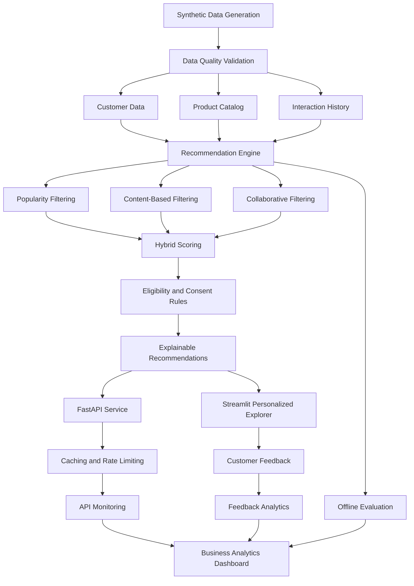

# FinReco — Personalized Financial Product Recommendation Engine

\<p align="center">   \<strong>An Explainable, Hybrid Recommendation System for Personalized Financial Product Discovery\</strong> \</p>

\<p align="center">   \   \   \   \   \   \ \</p>

\<p align="center">
&#x20; \<a href="[https://github.com/Rauof-Qadir/personalized-financial-recommender](https://github.com/Rauof-Qadir/personalized-financial-recommender)">GitHub Repository\</a>
\</p>

---

## Overview

FinReco is a personalized financial product recommendation engine designed to help customers discover relevant financial education resources and financial products based on their interests, interaction history, and customer profiles.

The system combines three recommendation approaches:

- **Popularity-Based Filtering:** Identifies products with strong engagement.
- **Content-Based Filtering:** Uses TF-IDF and cosine similarity to match product descriptions and customer interests.
- **Collaborative Filtering:** Finds behavioral similarities between customers using sparse interaction matrices.

A weighted hybrid recommendation engine combines these signals to generate personalized recommendations with explainable scoring.

The project also includes a FastAPI recommendation service, a Streamlit analytics dashboard, customer feedback collection, recommendation evaluation, caching, rate limiting, and API monitoring.

## Business Problem

Financial platforms often provide the same product suggestions to different customers, regardless of their interests or previous interactions.

This can result in:

- Irrelevant product discovery.
- Poor customer engagement.
- Limited personalization.
- Difficulty understanding why a recommendation was generated.

**FinReco addresses this problem** through personalized recommendations, behavioral signals, eligibility checks, and transparent recommendation explanations.

## Key Features

| Feature                   | Description                                                                |
| ------------------------- | -------------------------------------------------------------------------- |
| Synthetic Data Generation | Generates 1,000 customers, 50 products, and 20,000 interactions            |
| Data Quality Validation   | Checks missing values, duplicates, invalid events, and reference integrity |
| Popularity Filtering      | Ranks products using weighted interaction signals                          |
| Content-Based Filtering   | Uses TF-IDF and cosine similarity                                          |
| Collaborative Filtering   | Uses sparse matrices and customer similarity                               |
| Hybrid Recommendation     | Combines three recommendation approaches                                   |
| Eligibility Rules         | Applies consent, availability, age, and previously-seen product checks     |
| Explainability            | Displays recommendation score contributions                                |
| Offline Evaluation        | Measures Precision\@K, Recall\@K, NDCG\@K, coverage, and diversity         |
| FastAPI Service           | Exposes recommendation endpoints                                           |
| Recommendation Caching    | Uses TTL-based caching                                                     |
| API Rate Limiting         | Restricts recommendation requests                                          |
| API Monitoring            | Tracks response time, status codes, and cache performance                  |
| Streamlit Dashboard       | Provides interactive business analytics                                    |
| Customer Feedback         | Collects Helpful, Not Helpful, and Already Own This Product feedback       |
| Feedback Analytics        | Analyzes customer feedback and product-level responses                     |
| Automated Testing         | Includes 52 passing automated tests                                        |

## System Architecture



## Recommendation Methodology

### 1. Popularity-Based Filtering

Products receive weighted engagement scores based on customer interactions.

| Interaction | Weight |
| ----------- | -----: |
| View        |      1 |
| Click       |      2 |
| Save        |      3 |
| Enroll      |      5 |

This approach establishes a baseline for product popularity.

### 2. Content-Based Filtering

Uses:

- TF-IDF vectorization.
- Customer interest profiles.
- Product descriptions and tags.
- Cosine similarity.

The system identifies products whose content is similar to customer interests and preferences.

### 3. Collaborative Filtering

Uses:

- Customer-product interaction matrices.
- Sparse CSR matrices.
- Cosine similarity between customers.
- Weighted interaction history.

Recommendations are generated using the behavior of similar customers.

### 4. Hybrid Recommendation Engine

The final recommendation score combines normalized component scores:

[
H(u,i)=0.25P(u,i)+0.35C(u,i)+0.40CF(u,i)
]

Where:

- (P): Popularity score.
- (C): Content similarity score.
- (CF): Collaborative filtering score.
- (H): Final hybrid recommendation score.

The weights are configurable.

### 5. Recommendation Eligibility

Before recommendations are returned, the system checks:

- Customer consent.
- Product availability.
- Customer age eligibility where applicable.
- Previously seen products.

The system avoids generating recommendations for customers who have not granted the required consent.

## Offline Evaluation Results

The recommendation engine was evaluated using a chronological 80/20 temporal holdout split.

| Metric                         |  Result |
| ------------------------------ | ------: |
| Precision\@10                  |  0.0670 |
| Recall\@10                     |  0.4850 |
| NDCG\@10                       |  0.2490 |
| Catalog Coverage               |    100% |
| Available Products Recommended | 44 / 44 |
| Category Diversity             |  0.7773 |

**Evaluation configuration:**

- 100 evaluation users.
- Top 10 recommendations.
- Click, save, and enroll events treated as relevant interactions.
- Previously seen and unavailable products excluded.

These are offline results from a synthetic dataset. They should not be interpreted as measured real-world customer conversion, financial suitability, or production performance.

## Technology Stack

| Area                           | Technologies     |
| ------------------------------ | ---------------- |
| Language                       | Python 3.11      |
| Data Processing                | Pandas, NumPy    |
| Machine Learning               | Scikit-learn     |
| Similarity and Sparse Matrices | SciPy            |
| Model Persistence              | Joblib           |
| Backend API                    | FastAPI, Uvicorn |
| API Protection                 | SlowAPI          |
| Caching                        | Cachetools       |
| Dashboard                      | Streamlit        |
| Visualization                  | Plotly           |
| Testing                        | Pytest, HTTPX    |
| Data Storage                   | CSV, Parquet     |
| Version Control                | Git, GitHub      |

## Dashboard Modules

The Streamlit application includes:

1. **Executive Overview** — key business and recommendation metrics.
2. **Recommendation Analytics** — recommendation scores and product engagement.
3. **Personalized Explorer** — generates recommendations for individual customers.
4. **Customer Insights** — customer segments, age groups, consent, and interaction trends.
5. **Product Analytics** — catalog availability, categories, and engagement.
6. **API Monitoring** — latency, request status, cache performance, and request logs.
7. **Feedback Analytics** — customer feedback distribution and product-level analysis.

## API Documentation

The recommendation engine is exposed through FastAPI.

| Method | Endpoint     | Purpose                               |
| ------ | ------------ | ------------------------------------- |
| GET    | `/`          | API health and information            |
| POST   | `/recommend` | Generate personalized recommendations |
| GET    | `/docs`      | Interactive Swagger documentation     |

Example request:

```json
{
  "user_id": "U00003",
  "limit": 5
}
```

Start the API:

```powershell
uvicorn src.api.main:app --reload
```

Open interactive API documentation:

`http://127.0.0.1:8000/docs`

The API includes:

- Startup-loaded recommendation artifacts.
- Recommendation caching.
- Rate limiting.
- Structured logging.
- Request performance monitoring.

## Installation and Setup

### Prerequisites

- Python 3.11
- Git
- Windows, Linux, or macOS

### 1. Clone the repository

```bash
git clone https://github.com/Rauof-Qadir/personalized-financial-recommender.git

cd personalized-financial-recommender
```

### 2. Create a virtual environment

```bash
python -m venv .venv
```

### 3. Activate the environment

Windows PowerShell:

```powershell
.\.venv\Scripts\Activate.ps1
```

### 4. Install dependencies

```bash
pip install -r requirements.txt
```

### 5. Generate synthetic data

```bash
python -m src.data.generate_data
```

### 6. Generate recommendation artifacts

```bash
python -m src.recommenders.build_artifacts
```

### 7. Run the API

```bash
uvicorn src.api.main:app --reload
```

### 8. Run the dashboard

Open another terminal with the virtual environment activated:

```bash
streamlit run app/dashboard.py
```

### 9. Run automated tests

```bash
python -m pytest -v
```

## Project Structure

```text
personalized-financial-recommender/
│
├── app/
│   └── dashboard.py
│
├── data/
│   ├── raw/
│   ├── interim/
│   └── processed/
│
├── docs/
│
├── models/
│
├── notebooks/
│
├── reports/
│
├── src/
│   ├── api/
│   │   ├── main.py
│   │   └── schemas.py
│   │
│   ├── data/
│   │   ├── generate_data.py
│   │   └── data_quality.py
│   │
│   ├── evaluation/
│   │   ├── evaluate.py
│   │   └── feedback_analysis.py
│   │
│   ├── recommenders/
│   │   ├── popularity.py
│   │   ├── content_based.py
│   │   ├── collaborative.py
│   │   ├── hybrid.py
│   │   └── build_artifacts.py
│   │
│   └── utils/
│       ├── feedback.py
│       ├── logger.py
│       ├── monitoring.py
│       └── recommendation_cache.py
│
├── tests/
│
├── .gitignore
├── requirements.txt
└── README.md
```

## Testing

The project currently includes **52 automated tests passing**.

Tests cover:

- Recommendation algorithms.
- Hybrid recommendation scoring.
- Consent and eligibility rules.
- Recommendation evaluation metrics.
- API endpoints and validation.
- Rate limiting.
- Recommendation caching.
- Feedback storage and validation.
- Feedback analytics.
- Logging and monitoring.

Run the full test suite:

```bash
python -m pytest -v
```

## Responsible AI and Limitations

FinReco is an educational and engineering prototype built with synthetic data.

Important limitations:

- Synthetic interactions do not represent actual financial behavior.
- Offline recommendation metrics do not establish real-world business impact.
- Recommendations are not financial advice.
- The project does not establish whether a financial product is suitable for a particular customer.
- Customer consent and product eligibility checks are implemented as system-level safeguards.
- Production deployment would require additional security, privacy, fairness, regulatory, and real-world validation work.

## Future Improvements

Potential future development:

- Real-time recommendation feedback loops.
- Recommendation A/B testing.
- Model drift and data drift monitoring.
- Advanced fairness evaluation.
- Recommendation performance optimization.
- Production database integration.
- Containerized deployment and CI/CD.

## Author

**Rauof Qadir**

Software Engineer | Data Science & Machine Learning

GitHub: [@Rauof-Qadir](https://github.com/Rauof-Qadir)

---

\<p align="center">
&#x20; \<strong>FinReco — Turning Customer Interactions into Explainable Personalized Recommendations.\</strong>
\</p>
